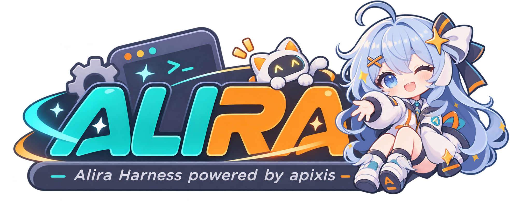

<div align="center">



# Alira

**模块化的 AI Agent 底座与运行时**


[](./LICENSE)

[快速开始](#快速开始) · [模块文档](./docs/README.md) · [问题反馈](https://github.com/JJJJSTIYYYY/alira/issues)

</div>

Alira 为构建 AI Agent 应用提供模型调用、上下文管理、工具接入与消息存储能力。
通过模块组合所需功能，让同一套运行时适应不同的应用场景。

项目处于早期开发阶段，接口与功能仍在演进。

## 主要能力

- **模块化运行**：按需选择启动模块，自动加载前置模块并安装所需依赖。
- **Agent 编排**：基于 [Apixis](https://github.com/JJJJSTIYYYY/apixis) 的事件与图执行能力，组织 Agent 的执行流程。
- **工具接入**：支持函数工具与 MCP，扩展 Agent 可调用的能力。
- **消息与存储**：提供上下文管理、消息持久化与可选的 SQLite 向量检索。

## 快速开始

需要 Python 3.12+ 和 [uv](https://docs.astral.sh/uv/)。从源码启动：

```bash
git clone https://github.com/JJJJSTIYYYY/alira.git
cd alira
uv sync --locked
uv run alira --web
```

默认可访问 <http://localhost:2712/health> 检查服务状态。
Web 模块的依赖会在加载时自动安装。

只启动内核可运行 `uv run alira`；查看可用模块与启动参数可运行 `uv run alira --help`。

PyPI 发行包名为 `alira-harness`，Python 导入名和命令均为 `alira`。

## 文档

[模块开发与依赖管理](./docs/README.md)：了解模块声明、依赖关系和生命周期。

## 社区

[QQ群](https://qun.qq.com/universal-share/share?ac=1&authKey=ommoQrT2zhzHU%2FUxv8pfGCJbNifW%2BJyUAFBkNdzkHTPUxdxCnlgxm5aNgGslTmdE&busi_data=eyJncm91cENvZGUiOiI2Mzk0NTkxNzIiLCJ0b2tlbiI6Im9ZZkdNUWZnSVV1Y2REeUhKNnlTbWEwc05Bb093djRzUXdXNE55dklBVnlBQk9XbGNpS0ZXSDlzK3orSW1sQ3YiLCJ1aW4iOiIzMTI5NDI0NTcyIn0%3D&data=OGTchcr80RAQg8Z8_GZTdvBb7kZDeM9B3hHcNqLaAX2ZK_KYq260C4CubblEBT1bK5fP6zgtnCk2D8fIoph1ZQ&svctype=4&tempid=h5_group_info) · [Discord](https://discord.gg/tUCQthwK5)

欢迎通过 [Issues](https://github.com/JJJJSTIYYYY/alira/issues) 反馈问题、讨论想法，或提交 Pull Request。

## 许可证

[GNU GPL v3.0](./LICENSE)
